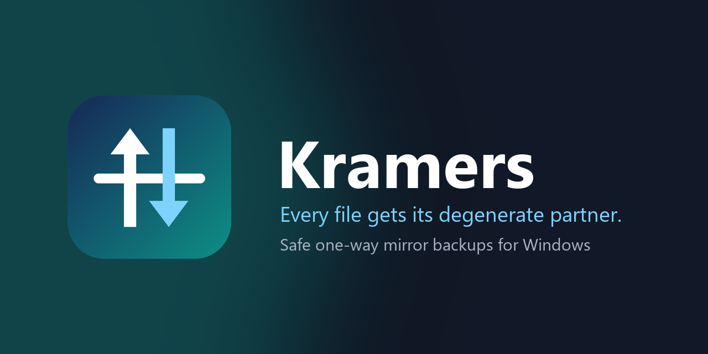
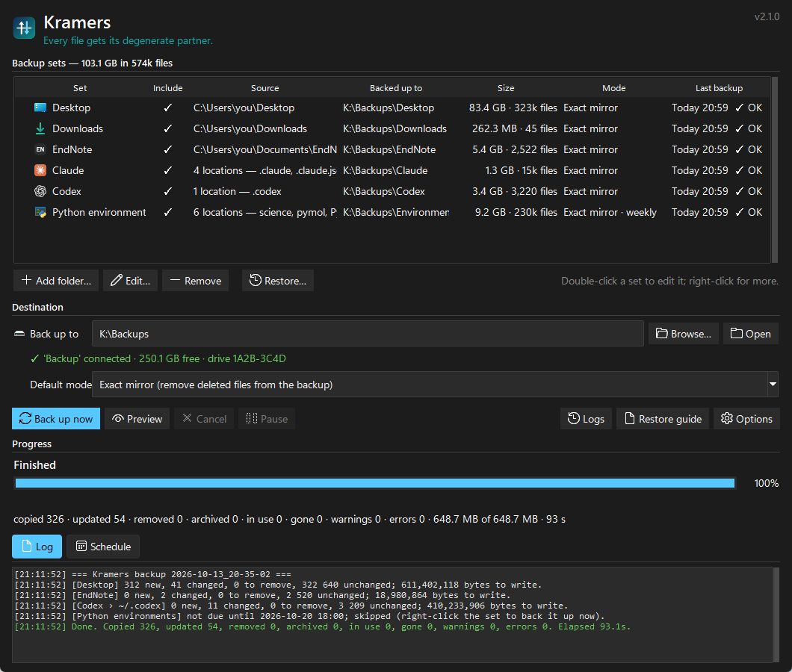
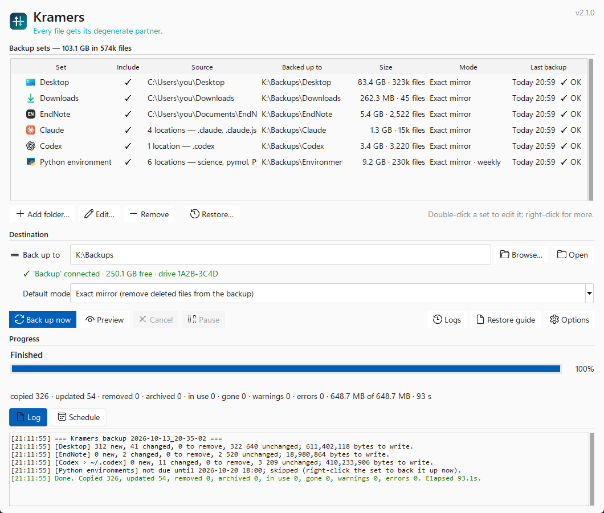
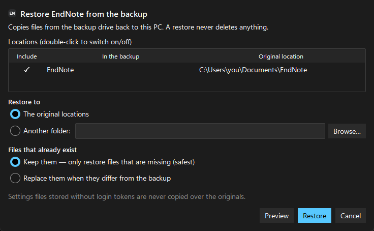

<p align="center">
  
</p>

<p align="center">
  <a href="https://github.com/Fisicas/kramers-backup/actions/workflows/tests.yml"></a>
  <a href="https://github.com/Fisicas/kramers-backup/releases/latest"></a>
  
  
  <a href="LICENSE"></a>
</p>

# Kramers

Kramers is a one-way mirror backup tool for Windows. It keeps an external drive
in step with your Desktop, Downloads, EndNote library, your **Claude and Codex
environments** (instructions, skills, plugins, memory, MCP servers and conversation
histories) and your **Python environments**. Its safety guards stop an exact
mirror from wiping your backup by mistake.

The name comes from Kramers degeneracy: under time-reversal symmetry every
half-integer-spin state has a partner of equal energy. Here, every file gets a partner on the backup drive.

<table>
  <tr>
    <td></td>
    <td></td>
  </tr>
  <tr>
    <td align="center"><sub>Dark mode</sub></td>
    <td align="center"><sub>Light mode (follows the Windows setting)</sub></td>
  </tr>
</table>

## Features

- **Backup sets with real Windows icons:** Desktop, Downloads, EndNote, Claude, Codex, Python environments, and any folder you add. Each set can be switched on or off, has its own mode and exclusions, and can run on every backup, daily, weekly or monthly.
- **Exact mirror, with safety guards.**
  - A missing or empty source never deletes its backup.
  - Mass deletions need your confirmation.
  - The tool never writes to the wrong drive.
  - Every backup can be previewed first.
- **Restore** a set to its original location or to another folder: only missing files, or missing and changed files. A restore never deletes anything.
- **Consistent copies of live databases:** SQLite and EndNote libraries are copied as proper snapshots, even while the app that owns them is running.
- **No login tokens in your backups.**
- **Gentle on your PC:** low-priority background copying, Pause/Resume, an optional speed limit, and a responsive window while the backup runs in its own process.
- **Runs in the background:** a notification-area icon, automatic backups while Kramers is open, a Windows scheduled task while it is closed, and notifications when something needs attention.
- **Python environments:** full copies plus rebuild recipes.
- **Encryption check:** Options shows whether the backup drive is BitLocker-encrypted, and can remind you in the main window.

## What the built-in sets cover

| Set | Source | Notes |
|---|---|---|
| **Desktop**, **Downloads** | the Windows known folders (relocated folders are followed) | |
| **EndNote** | `Documents\EndNote` (editable) | Library databases are snapshotted. A library EndNote holds locked is retried once EndNote is closed. `login.txt` is never copied. |
| **Claude** | `~\.claude`, `~\.claude.json`, the Claude desktop app's data (MSIX `LocalCache` or classic `%APPDATA%\Claude`), small parts of `~\.claude-science` | CLAUDE.md, settings, skills, plugins, per-project memory, sessions, MCP servers, extensions. Caches and the multi-GB VM bundle are skipped. |
| **Codex** | `~\.codex` | config.toml, AGENTS.md, skills, memories, automations, plugins, sessions and state databases. Logs, sandbox binaries and temp files are skipped. |
| **Python environments** | every `~\.venvs\*` and `~\miniconda3\envs\*` (also anaconda3, miniforge3, mambaforge), the base Python the venvs were built from, `~\.gitconfig`, `~\.config` | Full copies, plus `Environments\recipes` with `pip freeze`, `conda list --explicit` and `environment.yml` for each environment. |

On the backup drive:

```
<destination>\
├─ Desktop\  Downloads\  EndNote\
├─ Claude\        .claude\  .claude.json  AppData-Roaming-Claude-MSIX\  .claude-science\
├─ Codex\         .codex\
├─ Environments\  venvs\  conda-envs\  python-base\  dotfiles\  recipes\
├─ _archive\      versioned mode only (old versions; pruned after 30 days by default)
├─ _logs\         one log per run
├─ RESTORE.md     where each folder came from (regenerated after every backup)
└─ .kramers-target.json   identifies the drive
```

## Install

You need Windows 10 or 11 and Python 3.10 or newer from [python.org](https://www.python.org/downloads/windows/).

**From a download or clone of this repository**, double-click `tools\install_kramers.cmd` **in Explorer**. It installs the `sv-ttk` theme and creates Desktop and Start Menu shortcuts. Then open **Kramers**, choose the destination (an external drive is best), click **Preview** to see what will happen, and then click **Back up now**.

**With pip:**

```
py -m pip install kramers-backup
kramers            # opens the app (Options → "Create Desktop & Start Menu shortcuts")
```

Settings are kept in `%APPDATA%\Kramers\config.json`.

> Start the installer and the app from Explorer or their shortcuts, not from a terminal inside a packaged (MSIX) app such as the Claude desktop app. Windows redirects that terminal's AppData writes into the app's private storage.

### Uninstall

Double-click `tools\uninstall_kramers.cmd` in Explorer. It removes the shortcuts and the `Kramers` scheduled task, and asks before deleting the settings. Your backups and the program folder are never touched.

## Restoring

Select a set and click **Restore…** (or right-click the set).

<p align="center">
  
</p>

- **To the original locations or to another folder.** Restoring to another folder never touches your current files.
- **Only missing files (the safe default), or missing and changed files.**
- **Preview** shows what would be copied. A restore **never deletes** anything.
- Settings files that were stored without login tokens are not copied over the originals, so a restore never signs you out.
- Close Claude or Codex before restoring their data to the original locations.

On a new PC, install the apps first, then restore. `RESTORE.md` in the backup lists where every folder belongs. Python environments contain absolute paths: restore `python-base` first and keep the same Windows user name, or rebuild them from `Environments\recipes`.

## Modes

| Mode | Changed files | Removed files |
|---|---|---|
| **Exact mirror** (default) | overwritten | deleted from the backup |
| **Versioned** | old copy moved to `_archive` | moved to `_archive` |
| **Add & update only** | overwritten | never removed |

## Safety guards

- **Missing source:** the set is skipped and its backup is left untouched.
- **Empty source:** if a source folder is empty but its backup is not, nothing is deleted.
- **Mass deletions:** if a run would remove more than 20% of a set (and at least 50 files), or more than 5,000 files, **Back up now** asks first and shows the list. Unattended runs (scheduled, or automatic while Kramers is open) never stop to ask. By default they carry out the removals so the backup stays an exact mirror, and record them in the log. Options can make them keep the files and notify you instead. The thresholds are set in Options.
- **Wrong drive:** the backup drive's volume serial number is recorded. If another drive appears under the same letter, nothing is written until you choose **Use this drive**.
- **One run at a time:** a lock file on the backup drive stops the app and the scheduled task from overlapping.
- **Interrupted runs:** copies go to `*.kramers-partial` first and are renamed only when complete. Leftovers are cleaned up on the next run.
- **Files in use, or deleted mid-run,** are reported as *in use* or *gone* and retried next time. They are not counted as errors.

## Protect your backup drive

Your backups contain private files and AI conversation histories. **Encrypt the drive**: right-click it in Explorer and choose **Turn on BitLocker**. **Options** shows whether the destination is encrypted, has a shortcut to BitLocker settings, and can remind you in the main window (off by default). See [SECURITY.md](SECURITY.md) for what is and isn't copied.

## Running in the background

Closing the window keeps Kramers in the notification area. Click the icon to reopen it. Right-click the icon for Back up now, Pause/Resume, Cancel, the last-backup status and Quit. Starting Kramers again brings the running copy back.

- **While Kramers is open:** it can back up every N minutes (Schedule tab).
- **While it is closed:** the Schedule tab installs a Windows Task Scheduler task called `Kramers` (daily, hourly, every N hours, or at sign-in). If the drive is not connected, the run is skipped quietly. By default you get a notification only when something needs attention; you can change that in Options.
- **Per-set frequency:** big, rarely changing sets such as Python environments can be backed up weekly. Right-click a set to back it up now regardless.

Backups run in a separate process at **low priority**, so other programs stay responsive. **Pause** stops copying until you resume, and Options can cap the copy speed in MB/s. The first backup of a set is the slow one; later runs copy only what changed, although each run still scans the files to find the changes.

## Command line

```
pythonw Kramers.pyw                 # the app            (pip: kramers)
pythonw Kramers.pyw --run           # back up every set that is due   (pip: kramers-run)
python  Kramers.pyw --run --dry-run # preview in the console
python  Kramers.pyw --run --jobs desktop,codex
python  Kramers.pyw --uninstall
```

## Development

See [CONTRIBUTING.md](CONTRIBUTING.md) and [docs/DESIGN.md](docs/DESIGN.md).

```
python -X utf8 -m unittest discover -s tests -v
```

The app uses only the standard library plus `sv-ttk`. It falls back to the native theme without `sv-ttk`. Windows icons are taken from your own system at run time, so no third-party artwork ships in this repository.

## License

MIT. See [LICENSE](LICENSE).
